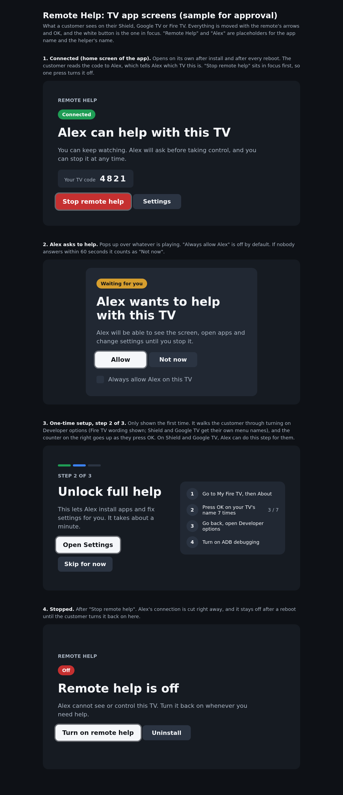

# tvctl

Set up and control Android TV, Google TV and Fire TV devices from anywhere, from
the command line. Built so a person or an AI agent can say "install Stremio on
these 20 TVs" and have it done in parallel.

- **One small Go binary.** Wraps adb: keys, typing, installs, settings,
  screenshots, an on-screen element list for agents, and YAML setup scripts that
  run on many TVs at once.
- **Works from any network, with no server to run or pay for.** The two ends find
  each other through public Nostr relays (two sealed notes) and free public STUN,
  then connect directly with WebRTC. See [docs/architecture.md](docs/architecture.md).
- **Consent first.** The TV owner turns on ADB, approves the helper once, and can
  stop it at any time.

> Status: early. The CLI works against TVs on the same network, and the direct
> link has been tested on a Fire TV Cube (bridge on another device) and an
> NVIDIA Shield (bridge on the TV itself). The TV/phone app
> with the consent screens is next.

## Quick start (same network)

```sh
go build -o tvctl ./cmd/tvctl
./tvctl add living-room 192.168.1.50      # turn on ADB debugging on the TV first
./tvctl info -t living-room
./tvctl install stremio.apk -t living-room
./tvctl ui -t living-room                 # what is on screen, for agents
./tvctl run stremio.yaml -g customers     # see docs/scripts.md
```

Add `--json` to any command for machine-readable output.

## From anywhere

On the customer's side (TV, or a phone on the same Wi-Fi for Fire TV), run the
bridge. It creates a pairing code file and waits:

```sh
tvlink --code-file tvlink.code --target <tv-ip>:5555
```

On the helper's machine, with a copy of that code:

```sh
tvctl link --code-file tvlink.code        # keeps running; use a second terminal
tvctl add customer 127.0.0.1:15555
tvctl screenshot -t customer -o shot.png
```

Fire TV refuses adb from apps on the TV itself, so there the bridge runs on
another device on the same Wi-Fi. See [docs/fire-tv.md](docs/fire-tv.md).

The TV owner first turns on ADB once; see [docs/setup.md](docs/setup.md).

## Docs

- [Customer setup, per device, with screenshots](docs/setup.md)
- [Architecture and connection modes](docs/architecture.md)
- [Why Fire TV needs a phone bridge](docs/fire-tv.md)
- [Setup scripts](docs/scripts.md)



## Use it responsibly

This gives full control of a TV. Only connect to devices whose owner has agreed,
and never share a pairing code you were given.

## License

MIT
