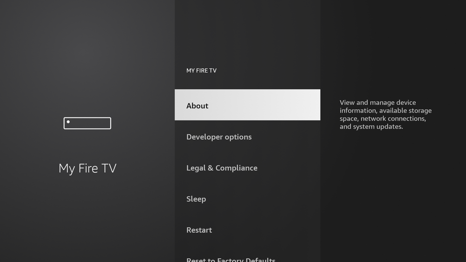
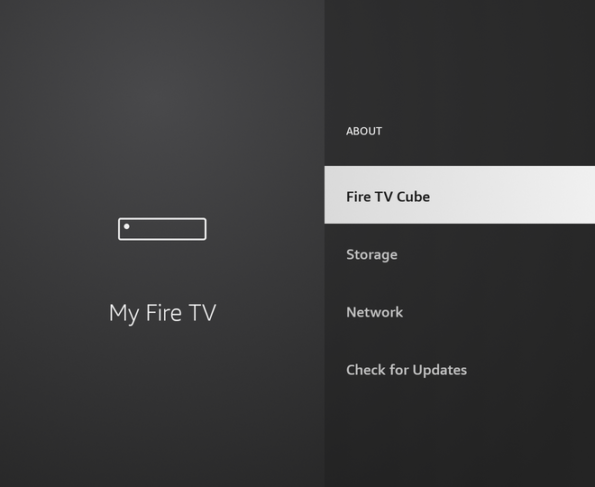
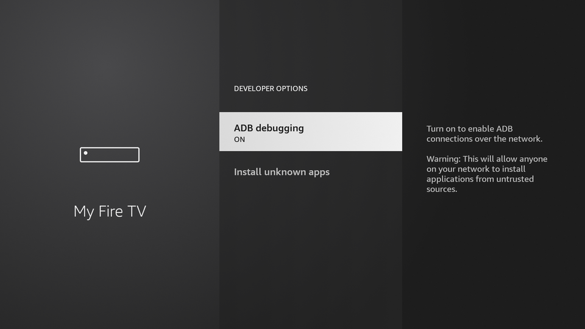
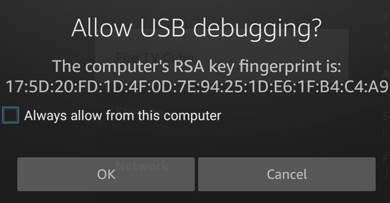

# Customer setup

What the TV owner does once, before a helper can connect. It takes about a
minute, survives reboots, and can be undone at any time by turning ADB off.

| Device | Unlock Developer options | Switch to turn on | App goes on |
|---|---|---|---|
| NVIDIA Shield | Device Preferences > About > **Build**, 7 presses | **Network debugging** | The TV |
| Google TV / Android TV | System > About > **Android TV OS build**, 7 presses | **USB debugging** | The TV |
| Fire TV (Stick, Cube) | My Fire TV > About > **device name**, 7 presses | **ADB debugging** | A phone on the same Wi-Fi ([why](fire-tv.md)) |

Then, on every device, the first time a helper connects: tick **Always allow
from this computer** and press **OK**.

Two different switches, often confused:

- **ADB (Developer options)** is what lets the helper control the TV. Required.
- **Unknown sources / Install unknown apps** only lets an app such as Downloader
  install APKs. It is needed only if the app is sideloaded instead of coming
  from an app store. Once ADB is on, the helper's installs do not need it.

## Fire TV

1. Settings (gear) > **My Fire TV** > **About**.

   

2. Press the first item, the device name (**Fire TV Stick**, **Fire TV Cube**,
   ...), 7 times, until "You are now a developer" appears.

   

3. Go back to **My Fire TV** > **Developer options** > **ADB debugging** >
   **ON**. (Install unknown apps, below it, is not needed.)

   

4. On the phone: install the app, join the same Wi-Fi as the TV, share the code.
5. When the helper first connects, this appears on the TV. Tick **Always allow
   from this computer**, then press **OK**.

   

Screenshots from a Fire TV Cube (3rd gen), Fire OS 7.7.1.7. Sticks use the
same menus.

## NVIDIA Shield

1. Settings > **Device Preferences** > **About**, press **Build** 7 times.
2. Settings > **Device Preferences** > **Developer options** > **Network
   debugging** > on. (The Shield's helper connects over the network, so this is
   the switch that matters; USB debugging can stay off.)
3. Install the app on the Shield and share the code.
4. Tick **Always allow from this computer** and press **OK** when it appears.

Sideloading the app instead of installing it from Google Play: Settings >
**Device Preferences** > **Security & restrictions** > **Unknown sources**, allow
the downloader app.

Checked on a Shield with Android 11: Network debugging on and USB debugging off
is enough.

## Google TV and other Android TV

1. Settings > **System** > **About**, press **Android TV OS build** 7 times.
2. Settings > **System** > **Developer options** > **USB debugging** > on.
3. Install the app on the TV and share the code.
4. Tick **Always allow from this computer** and press **OK** when it appears.

Sideloading: Settings > **Apps** > **Security & restrictions** > **Unknown
sources**, allow the downloader app.

Not yet tested on a Google TV device; menu names can differ slightly by brand.

## Turning it off

- Close or stop the app: the helper is disconnected.
- Turn ADB / Network / USB debugging off: no helper can connect until it is
  turned back on.
